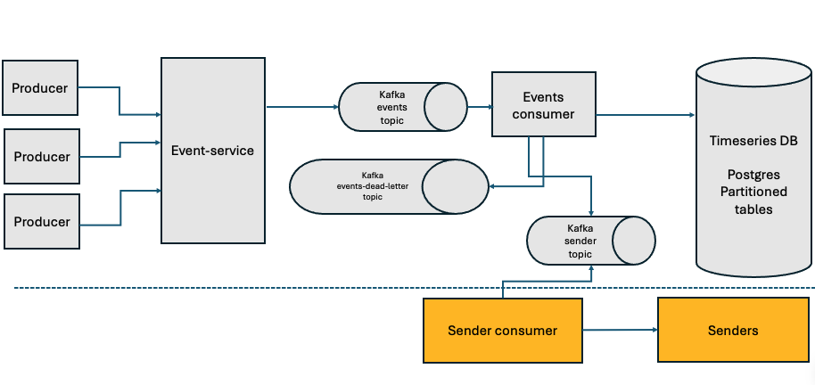

## Problem : Real-Time Event Processor 

The goal of the system is to develop an event processor component that can ingest and process large volumes of events and deliver them to specific clients for further processing. 

Incoming events can be generated by various producers and must conform to the schemas and formats specified by the system. The system should be resilient to system failures and service restarts, each event must be processed at least once and non-complaint events should be stored in the system for auditing purposes.
 

## Architecture Overview 
The system provides several interfaces, including HTTP and gRPC servers, through which producers can submit events. The system queues incoming events in Kafka topics. 



A single Kafka consumer function reads events from a Kafka topic, validates them, and stores each event along with its validation result in a backend database. If validation succeeds, the event is published to another Kafka topic for consumption by sender components.   

Backend database is used in the system is Postgres with partitioned tables to handle timeseries events more efficiently. In a production environment, a full-fledge timeseries like influxDB, clickhouse, etc. will be a better fit. 

## Event Data Model 
system expects the following event data model 
* Type:      string      - event type unique per producer
* TenantID:  string      - same as client id 
* version:   string      - event schema version
* timestamp: number      - event timestamp  
* payload: string        - event data in json format, the content of this field gets validated against of schema version 


## Detail Design
The system is composed of the following pieces:
* http service : used by http clients, demo env and integration tests
    * This service provides the following two endpoints:
        * Create event endpoint: 
        __POST /api/v1/events__
        ```
            curl --location 'http://localhost:88/api/v1/events' \
            --header 'Content-Type: application/json' \
            --data-raw '{                
                "type" : "type1",
                "tenant_id" : "tenant1",
                "version" : "1.0",
                "timestamp" : 1791700437,
                "payload" : "{ \"name\" : \"testUser\", \"email\" : \"testUser@email.com\" } "
            }
            '        
        ```
        * Check event existence: __GET /api/v1/events/{id}__
        ```
            curl --location 'http://localhost:88/api/v1/events/ba959f27-1f80-40c8-8d5c-46ea61b3fad3'
        ```
* grpc service : used mostly by internal microservices use cases
    * provides CreateEvent endpoint 
    ```
    message CreateEventRequest {        
        string type      = 1;
        string tenant_id = 2;
        string version   = 3;
        google.protobuf.Timestamp event_timestamp = 4;
        string payload   = 5;
    }

    message CreateEventResponse {
    }

    service EventService {
    rpc CreateEvent(CreateEventRequest) returns (CreateEventResponse);
    }
    ```
* kafka server
    * kafka "events" topic : all incoming events queued up in this topic        
    * kafka "events-deadletter" topic: all events that failed consumer processing added to this topic. A consumer can be added to store this topic to a database or AWS S3.  
    * kafka "sender" topic: all valid events that pass consumer processing added to this topic to be used by senders application consumers
* kafka consumer 
    * validates incoming events 
    * stores events into database along with their validation status 
    * if valid event, routes the event to sender topic used by sender consumers
    * in case of any failure, retried for a number of time. if all attempts fail, inserts the event to deadletter queue.
    * in case of successful processing, commits topic offset. it uses manual topic offset.

* postgres db
    * "events_partitioned" table partitioned by date for each month 
    * "events" global table to enforce uniqueness of event ids 
    * initial table scripts included in ./init-scripts/init.sql 


## Local Deployment
This service and its dependencies can be all deployed in a local environment via the following docker compose command:
```
    $ docker compose up -d
```


## Build 
    $ make build

## Running Tests
* Running unit-tests:  
    * ```$ make test ```
* Running all tests including integration tests:
    * ```$ make integration-test ```

